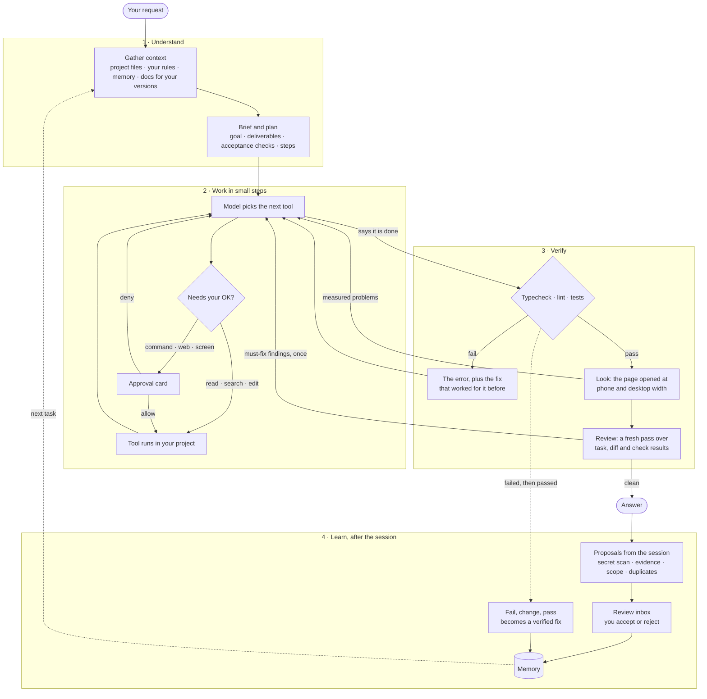
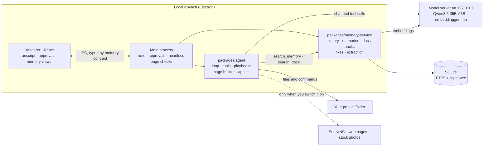

<h1 align="center">Local Kovach</h1>

<p align="center">
  A coding agent for macOS that runs entirely on your own machine<br>
  and gets better at your work over time, without retraining the model.
</p>

<p align="center">
  
  
  
</p>

Local Kovach is a desktop app that plans a task, edits your project in small steps, runs your checks, reviews its own diff and only then says it is done. The model, your code, the conversation history and everything it learns stay on your Mac.

The name comes from the Bosnian *kovač*, a smith: the one who forges and reshapes tools. "Local" because nothing leaves your machine.

> **Status: early.** It is used daily by its author on one machine and is built from source. There is no signed release yet, and the interfaces still change. The design is in [MASTER_PLAN.md](MASTER_PLAN.md); progress is in [docs/ROADMAP.md](docs/ROADMAP.md).

## What it does

### Works in your project
- **Brief, plan, small steps.** Every task is first restated as a short ticket (goal, deliverables, acceptance checks, assumptions) and a plan you can read before anything is changed.
- **Checks decide when it is done.** After editing it runs your typecheck, lint and tests. A failing check goes back to the model with the error and, when it has seen that error before, the fix that worked.
- **A second look.** Before finishing, a fresh pass reads only the task, the diff and the check results, and sends real problems back once.
- **Precise context.** The TypeScript language service and Tree-sitter give it definitions, references and outlines instead of whole files.

### Remembers, and shows you what it remembers
- **Preferences, decisions and conventions** you stated, per project or for all projects. Nothing is saved without your approval: proposals wait in a review inbox with the messages they came from.
- **Verified fixes.** When a check fails, files change and the same check passes, the problem, the fix and the lesson are kept and offered the next time that error shows up.
- **Every session**, searchable, resumable, and yours to rename or delete.
- **Version-matched docs.** It indexes the official documentation for the library versions your project actually uses (React Native, Expo, React, Next.js, Node.js, TypeScript, Laravel, PHP, WordPress, WooCommerce and any npm library with docs in its repo).

### Builds things that hold up
- **Web pages and landing pages.** The model supplies the content; a page builder renders a full page in one of four design directions, with a logo mark, motion, form validation and search-engine tags. With web access on, it finds stock photos under public-domain or attribution licences and writes the credits. The page is then opened in a headless browser at phone and desktop widths, and measured problems go back to the model. Facts only the owner knows are left as `[placeholders]`, never invented.
- **React Native apps.** A new app is created with Expo's own generator, then an app kit adds the architecture: one API client with zod validation, TanStack Query, design tokens, accessible UI primitives, a folder per feature with list and detail screens, optional sign-in with the token in secure storage, navigation and EAS build profiles. Playbooks cover React Native, native iOS and Android, and building, signing and store submission. It prepares a release; you publish it.

### Uses tools, with your say
- **Terminal commands ask first.** "Allow for this session" covers commands of the same kind (`npx tsc …`) and says so on the button; anything that installs, deletes or publishes is asked about every time.
- **Web search and page fetching**, switched on per run: through your own SearXNG instance when one is configured, otherwise a keyless fallback.
- **Images in and out.** Paste a screenshot into a task; generate images locally with FLUX.2 [klein] through MLX.
- **Computer use, opt-in per run**: reads the front window through the accessibility tree and clicks controls by id.

## How it works

One task, from request to answer:



What runs where:



The specifics:

| Stage | What happens |
| --- | --- |
| Context | Memory is found by hybrid search (BM25 and vectors, merged by reciprocal rank fusion) and each task gets a small ranked slice of it. Docs come from packs built for the library versions in your lockfile. The always-on part of the prompt is built once per session so the model's prompt cache holds. |
| Plan | The plan is strict JSON with a brief (goal, deliverables, requirements, acceptance checks, assumptions). Built-in playbooks for the kind of project and change are part of the planning prompt. |
| Model | Sampling follows the model card for precise coding (temperature 0.6, top_p 0.95, top_k 20); review and extraction run greedy. |
| Loop guards | A tool call the server could not parse is retried. A reply that repeats itself is thrown away. The same call with the same arguments gets a note, then stops the run. Old tool output is trimmed once the conversation is long. A task has at most 40 turns and 3 rounds of failing checks. |
| Forced steps | For a new page only the page builder is offered until the page exists; for a new app the loop runs Expo's generator itself and offers only the app kit until the architecture is in. |
| Approvals | Commands, web access, screen control and image generation ask first. Memory saves are asked about one by one, always. |
| Verify | Checks come from the project (typecheck, lint, tests). The review is a separate pass that sees only the task, the diff and the results, answers in strict JSON, and can send the work back once. |
| Learn | When a session is finished or idle for ten minutes, at most five proposals are extracted, each with the message it rests on. A fix is kept only when the same check failed, files changed, and it passed in one session. |

## What stays on your machine

Everything, by default: models, conversations, memory, documentation packs and search queries. There is no telemetry. Secrets are scanned for and removed before anything is written to memory or history, by a deterministic scanner rather than by the model.

## Why it is built this way

A local 35B model is not a frontier model, and the app is designed around that. Whatever must happen is done by a tool or enforced by the loop, not asked for in a prompt: the page builder renders pages from data, the loop runs the project generator itself, repeated or empty replies are caught and sent back. Each failure seen in real runs and the safeguard for it is listed in [docs/MODEL_NOTES.md](docs/MODEL_NOTES.md).

## Requirements

| | |
| --- | --- |
| Machine | Apple Silicon Mac with 32 GB unified memory or more (developed on an M4 Pro, 48 GB) |
| Main model | Qwen3.6-35B-A3B, 4-bit (about 20–22 GB) |
| Embeddings | embeddinggemma-300m |
| Model server | [oMLX](https://omlx.ai) on `127.0.0.1:8000`, or another OpenAI-compatible local server |
| Web search (optional) | SearXNG in Docker, see [`infra/searxng`](infra/searxng) |
| Image generation (optional) | installed on demand by the app |

## Getting started

```sh
git clone https://github.com/feridbrkovic/kovach.git
cd kovach
corepack enable
pnpm install
pnpm --filter @kovach-dev/desktop dev   # or double-click scripts/start-mac.command
```

Start oMLX with the model loaded first. Node 22 or newer.

To build an unsigned DMG for your own Mac, run `scripts/build-dmg.command`.

```sh
pnpm typecheck
pnpm test
pnpm eval        # retrieval and extraction evals against the public fixtures
```

## Repository layout

```
apps/desktop/              Electron app: main process, preload bridge, React UI
packages/agent/            Agent loop, tools, playbooks, page builder, app kit
packages/memory-contract/  Shared types and zod schemas for the memory API
packages/memory-service/   SQLite storage, retrieval, docs packs, fixes, extraction
packages/agent-fixtures/   Record agent sessions as fixtures; replay them with a scripted model
packages/evals/            Eval runner
evals/                     Public eval fixtures
infra/searxng/             Local SearXNG for web search
docs/                      Roadmap, model notes, assets
```

## What is next

Skills learned by research (`/learn <topic>`), connectors and automations over MCP, a stronger second model for hard tasks, simulator and device control, and a phone companion app. See the [roadmap](docs/ROADMAP.md).

## Contributing and security

Read [CONTRIBUTING.md](CONTRIBUTING.md) before opening a pull request. Report vulnerabilities privately as described in [SECURITY.md](SECURITY.md).

## License

[Apache-2.0](LICENSE). Models, SearXNG and documentation packs are downloaded on your machine under their own licences and are not part of this repository.
